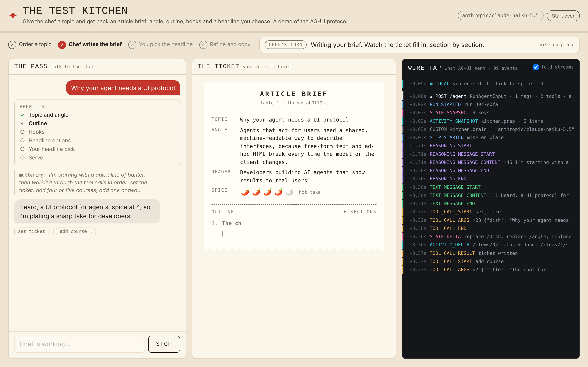
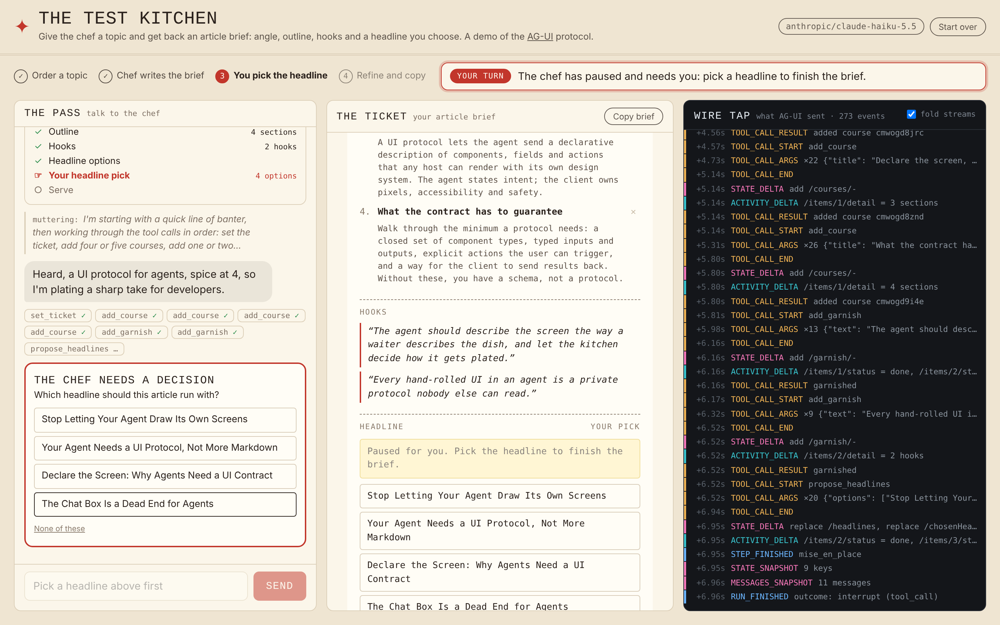

# The Test Kitchen

An [AG-UI](https://docs.ag-ui.com/introduction) demo. You name a topic, a line-cook agent turns it into an article brief on a live order ticket, and a wire tap shows every protocol event that made it happen.


There is no agent framework here. The server is about 200 lines of TypeScript that reads a `RunAgentInput` and writes AG-UI events over SSE. The browser uses the official `@ag-ui/client`. That makes it a good place to see what the protocol itself does.

## Run it

```bash
npm install
```

```bash
npm run dev
```

Open http://localhost:5173. One process serves both the UI and the agent endpoint (`POST /agent`).

With no API key the kitchen runs a scripted chef that speaks exactly the same protocol. For a real model, copy `.env.example` to `.env` and set `OPENROUTER_API_KEY`. `KITCHEN_MODEL` takes any OpenRouter model that supports tool calling.

## Things to try

The bar across the top always says which step you are on and whose turn it is.

1. Set the spice dial, then click a starter topic. The ticket fills in as the model types, before each section is even saved.
2. The chef pauses and asks you to pick a headline. Pick one, or send them all back.
3. Tap one of the chef's suggested follow-ups, or edit the ticket by hand (rename or delete a section, turn the spice dial) and then ask for changes. The chef is told what you touched.
4. Ask for "fine dining" or "food truck vibes".
5. Hit Stop mid-run, then carry on.
6. Click any row in the wire tap for the raw JSON.

## What each part demonstrates

| You see | AG-UI feature | Where |
| --- | --- | --- |
| Chef's banter streaming in | `TEXT_MESSAGE_START / CONTENT / END` | `server/agent.ts` |
| The "muttering" lines | `REASONING_*` events from the model's thinking | `server/agent.ts` |
| Tool chips under a message | `TOOL_CALL_START / ARGS / END / RESULT` | `server/agent.ts` |
| Ticket updating live | Shared state: `STATE_SNAPSHOT`, then `STATE_DELTA` JSON Patches | `server/kitchen.ts` |
| Faded rows typing themselves onto the ticket | Streaming tool arguments: the client parses partial `TOOL_CALL_ARGS` and previews the result before it lands in state | `src/main.ts` |
| The prep list checklist in the chat | `ACTIVITY_SNAPSHOT / ACTIVITY_DELTA`: structured progress, patched in place | `server/agent.ts` |
| "Chef suggests" chips | Agent-driven UI: a tool writes next steps into shared state | `server/kitchen.ts` |
| Your hand edits reaching the chef | State flows both ways: `agent.setState()` rides in the next `RunAgentInput.state`, and what you changed goes in `RunAgentInput.context` | `src/main.ts` |
| The headline pause | Interrupts: `RUN_FINISHED` with `outcome: interrupt`, resumed with `RunAgentInput.resume`. The decision card is built from the interrupt's `message` and `responseSchema` | both |
| The Stop button | `agent.abortRun()`; the server drops orphaned tool calls on the next run | both |
| Confetti, bell, redecorating | Frontend tools: declared by the browser, called by the agent, executed in the tab | `src/main.ts` |
| The step label in the guide bar | `STEP_STARTED / STEP_FINISHED` | both |
| The model badge | `CUSTOM` event | both |





## How it fits together

```
src/main.ts      HttpAgent, frontend tools, rendering from agent.messages + agent.state
src/wiretap.ts   the event log
server/agent.ts  the AG-UI endpoint: RunAgentInput in, event stream out
server/kitchen.ts  the ticket, the server tools, and the JSON Patch each one emits
server/llm.ts    OpenRouter streaming, plus the scripted chef
vite.config.ts   mounts the endpoint on Vite's dev server
```

Three design points worth noticing:

- **The server holds no session.** Messages, the ticket, and even a paused run arrive in each request. An interrupt's id encodes the tool call it is waiting on and the prep list to update, so the resume request carries everything needed to continue.
- **The UI's guidance comes from the protocol, not from guesswork.** Whose turn it is comes from run state and pending interrupts, progress from activity events, next steps from the agent.
- **Server tools run as each call finishes streaming**, not at the end of the model's turn. That is why the ticket fills in one course at a time.
- **A frontend tool call ends the run without a result.** The browser executes it, appends a `tool` message, and starts a follow-up run so the agent can react. See `run()` in `src/main.ts`.

## Notes

- Built against AG-UI 1.0 (`@ag-ui/client`, `@ag-ui/core`, `@ag-ui/encoder` 1.0.5).
- This is a demo: there is no auth or rate limiting on `/agent`, so don't expose it publicly with a key configured.
