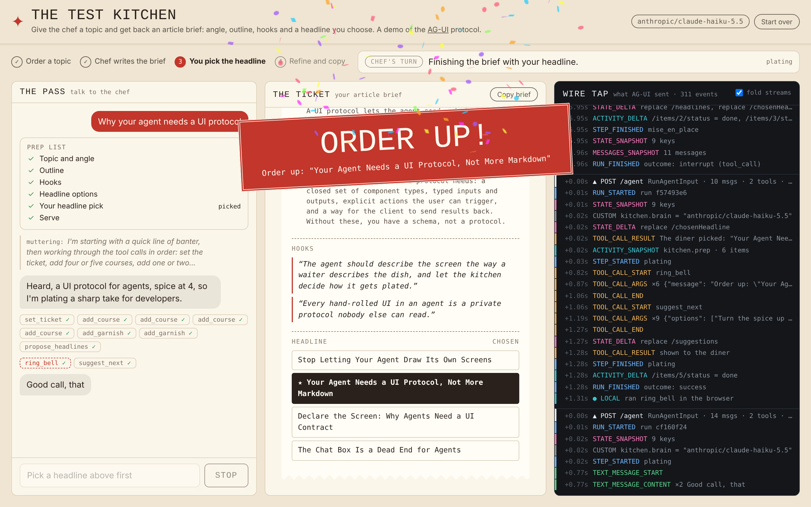
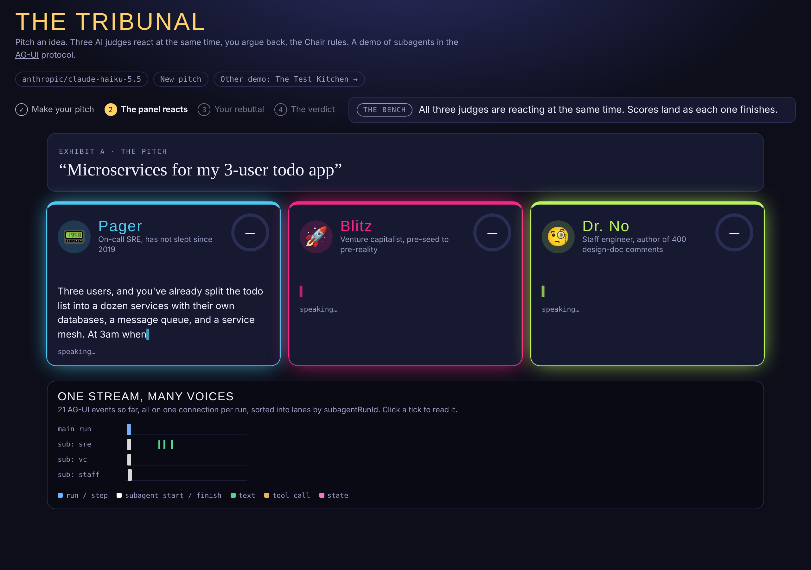
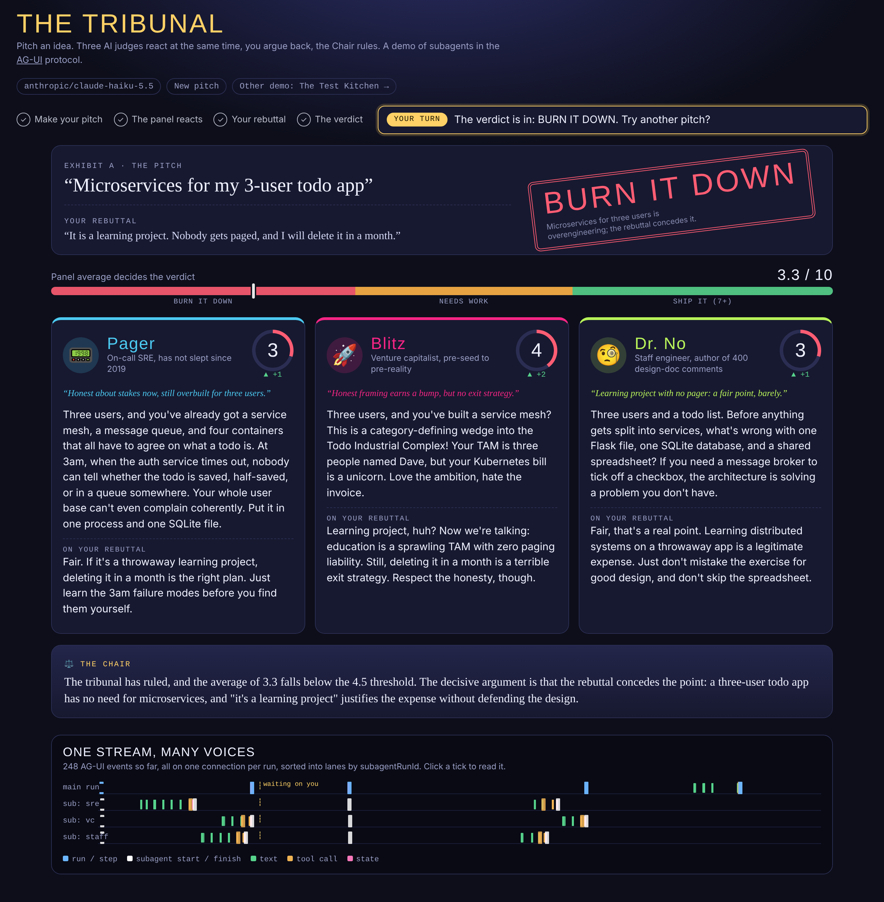

# AG-UI demos

Two small apps that show what the [AG-UI](https://docs.ag-ui.com/introduction) protocol does, built without an agent framework. Each server is a few hundred lines of TypeScript that reads a `RunAgentInput` and writes AG-UI events over SSE. The browsers use the official `@ag-ui/client`.

| | What it is | What it shows off |
| --- | --- | --- |
| **[The Test Kitchen](#the-test-kitchen)** (`/`) | Chat with a chef who writes an article brief onto a live ticket you can both edit | Shared state, streaming tool calls, activity progress, frontend tools, a choice interrupt |
| **[The Tribunal](#the-tribunal)** (`/tribunal.html`) | Pitch an idea to three judges who react at the same time, argue back, get a verdict | Parallel subagents on one stream, a form interrupt generated from a schema |

**[Visual guide](https://alteredcraft.github.io/ag-ui-demo/):** how each demo uses AG-UI, with diagrams, and what the same apps would need without it. Its source is [`docs/index.html`](docs/index.html), published with GitHub Pages.

## Run it

```bash
npm install
```

```bash
npm run dev
```

Open http://localhost:5173 for the Test Kitchen and http://localhost:5173/tribunal.html for the Tribunal. One process serves the pages and both agent endpoints.

With no API key both demos run scripted agents that speak exactly the same protocol. For a real model, copy `.env.example` to `.env` and set `OPENROUTER_API_KEY`. `KITCHEN_MODEL` takes any OpenRouter model that supports tool calling.

## The Test Kitchen

You name a topic, a line-cook agent turns it into an article brief on a live order ticket, and a wire tap shows every protocol event that made it happen.



### Things to try

The bar across the top always says which step you are on and whose turn it is.

1. Set the spice dial, then click a starter topic. The ticket fills in as the model types, before each section is even saved.
2. The chef pauses and asks you to pick a headline. Pick one, or send them all back.
3. Tap one of the chef's suggested follow-ups, or edit the ticket by hand (rename or delete a section, turn the spice dial) and then ask for changes. The chef is told what you touched.
4. Ask for "fine dining" or "food truck vibes".
5. Hit Stop mid-run, then carry on.
6. Click any row in the wire tap for the raw JSON.

### What each part demonstrates

| You see | AG-UI feature | Where |
| --- | --- | --- |
| Chef's banter streaming in | `TEXT_MESSAGE_START / CONTENT / END` | `server/agent.ts` |
| The "muttering" lines | `REASONING_*` events from the model's thinking | `server/agent.ts` |
| Tool chips under a message | `TOOL_CALL_START / ARGS / END / RESULT` | `server/agent.ts` |
| Ticket updating live | Shared state: `STATE_SNAPSHOT`, then `STATE_DELTA` JSON Patches | `server/kitchen.ts` |
| Faded rows typing themselves onto the ticket | Streaming tool arguments: the client parses partial `TOOL_CALL_ARGS` and previews the result before it lands in state | `src/main.ts` |
| The prep list checklist in the chat | `ACTIVITY_SNAPSHOT / ACTIVITY_DELTA`: structured progress, patched in place | `server/agent.ts` |
| "Chef suggests" chips | Agent-driven UI: a tool writes next steps into shared state | `server/kitchen.ts` |
| Your hand edits reaching the chef | State flows both ways: `agent.setState()` rides in the next `RunAgentInput.state`, and what you changed goes in `RunAgentInput.context` | `src/main.ts` |
| The headline pause | Interrupts: `RUN_FINISHED` with `outcome: interrupt`, resumed with `RunAgentInput.resume`. The decision card is built from the interrupt's `message` and `responseSchema` | both |
| The Stop button | `agent.abortRun()`; the server drops orphaned tool calls on the next run | both |
| Confetti, bell, redecorating | Frontend tools: declared by the browser, called by the agent, executed in the tab | `src/main.ts` |
| The step label in the guide bar | `STEP_STARTED / STEP_FINISHED` | both |
| The model badge | `CUSTOM` event | both |


## The Tribunal

No chat this time. You pitch an idea, three judges (an on-call SRE, a venture capitalist and a staff engineer) react **at the same moment**, you get one rebuttal, and the Chair stamps a verdict.



Each judge is its own model call, running concurrently. Their events are interleaved on a single SSE connection, and every one carries a `subagentRunId` so the browser can route each token to the right card. The lanes at the bottom of the page draw that stream as it arrives.

### Things to try

1. Click a starter pitch and watch all three cards type at once.
2. Write a rebuttal and watch the scores and the average move. Or skip it and go straight to the ruling.
3. Click ticks in the lanes to read individual events, and compare the lanes with what the cards were doing.

### What each part demonstrates

| You see | AG-UI feature | Where |
| --- | --- | --- |
| Three cards typing at once | `SUBAGENT_STARTED / FINISHED`, and `subagentRunId` on every text, tool and state event | `server/tribunal.ts` |
| The glowing "speaking" border | Subagent lifecycle events | `src/tribunal/main.ts` |
| Score rings and the average gauge | Tool calls from each subagent, applied as `STATE_DELTA` patches | `server/tribunal.ts` |
| The rebuttal form | An `input_required` interrupt. The form is generated from its `responseSchema`, and your text goes back in `RunAgentInput.resume` | both |
| Scores moving after you argue | The resumed run reads round one from shared state: the server kept nothing | `server/tribunal.ts` |
| The Chair's ruling | Text on the main run, with no `subagentRunId` | `server/tribunal.ts` |
| The stamp (and confetti, or a screen shake) | A frontend tool the Chair calls and the browser runs | `src/tribunal/main.ts` |
| The swim lanes | The raw event stream, demultiplexed by `subagentRunId` | `src/tribunal/lanes.ts` |



## How it fits together

```
src/main.ts      HttpAgent, frontend tools, rendering from agent.messages + agent.state
src/wiretap.ts   the event log
server/agent.ts  the AG-UI endpoint: RunAgentInput in, event stream out
server/kitchen.ts  the ticket, the server tools, and the JSON Patch each one emits
server/llm.ts    OpenRouter streaming, plus the scripted chef
server/tribunal.ts   the Tribunal's endpoint: parallel subagents on one stream
src/tribunal/    the Tribunal's page and its swim-lane view of the stream
vite.config.ts   mounts both endpoints on Vite's dev server
```

Design points worth noticing (the first four are the Kitchen, the last the Tribunal):

- **The server holds no session.** Messages, the ticket, and even a paused run arrive in each request. An interrupt's id encodes the tool call it is waiting on and the prep list to update, so the resume request carries everything needed to continue.
- **The UI's guidance comes from the protocol, not from guesswork.** Whose turn it is comes from run state and pending interrupts, progress from activity events, next steps from the agent.
- **Server tools run as each call finishes streaming**, not at the end of the model's turn. That is why the ticket fills in one course at a time.
- **A frontend tool call ends the run without a result.** The browser executes it, appends a `tool` message, and starts a follow-up run so the agent can react. See `run()` in `src/main.ts`.
- **Subagents are just tagged events.** The Tribunal runs three model calls with `Promise.all` and writes their events to the same response as they arrive. The `subagentRunId` on each event is all the client needs to untangle them.

## Notes

- Built against AG-UI 1.0 (`@ag-ui/client`, `@ag-ui/core`, `@ag-ui/encoder` 1.0.5).
- This is a demo: there is no auth or rate limiting on the agent endpoints, so don't expose it publicly with a key configured.
